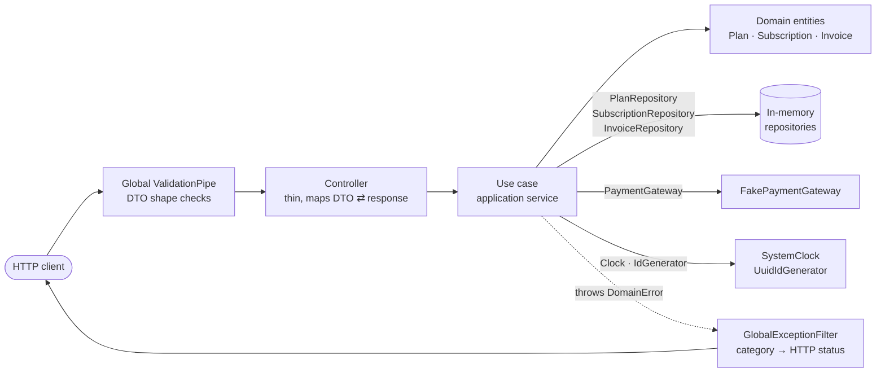
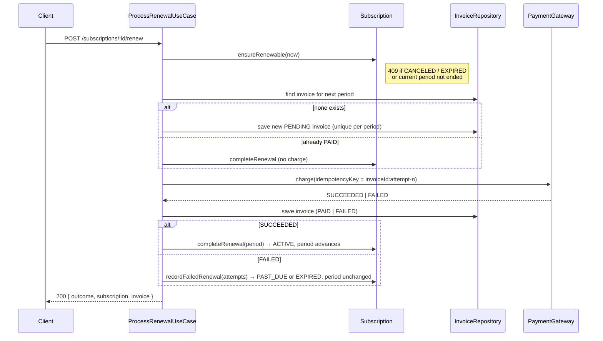
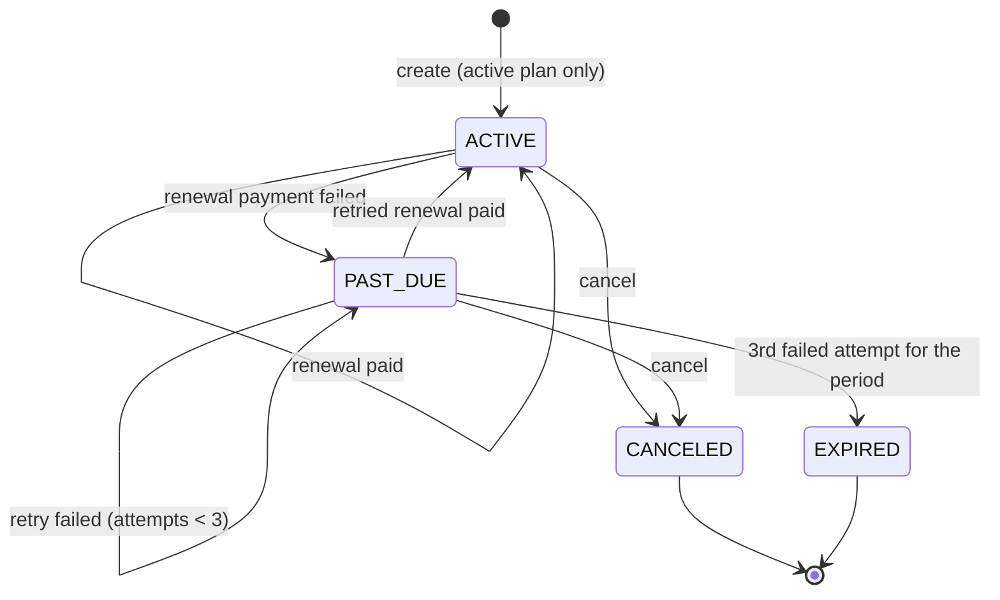

# Subscription & Billing Engine

A modular **NestJS + TypeScript** backend that manages SaaS subscription plans, the subscription
lifecycle, per-period invoices and payment outcomes. It is a portfolio project. It focuses on
clear domain modeling, explicit state transitions, idempotent billing and thorough automated tests.

> **Scope notice.** Payments are **simulated** by an in-process fake gateway and all data lives in
> **in-memory repositories**, so it is lost on restart. No real payment provider is called and no money moves.
> This project is **not** production-ready for real financial transactions.

## Key features

- **Plans** with integer minor-unit prices, ISO 4217 currency codes, monthly/yearly intervals and
  activation status.
- **Subscription lifecycle** (`ACTIVE`, `PAST_DUE`, `CANCELED`, `EXPIRED`) enforced by an explicit
  state machine in the domain layer.
- **Price snapshots**: a subscription locks in the plan's price, currency and interval, and every
  invoice keeps its own copy.
- **Calendar-correct billing periods** in UTC, with documented month-end and leap-year behavior.
- **Idempotent renewals**: one invoice per subscription and period, idempotency keys for charges,
  and safe recovery from partial failures.
- **Idempotent cancellation**: repeating a cancel has no extra side effects.
- **Consistent error responses** produced by a single global exception filter.
- **Unit and HTTP integration tests**, with coverage thresholds enforced in CI.

## Technology stack

| Concern      | Choice                                                            |
| ------------ | ----------------------------------------------------------------- |
| Runtime      | Node.js 24 (LTS)                                                  |
| Language     | TypeScript 6.0, `strict` mode, native ES modules                  |
| Framework    | NestJS 12 (Express platform)                                      |
| Validation   | class-validator + class-transformer via a global `ValidationPipe` |
| Testing      | Jest 30 (ESM mode) + ts-jest, Supertest, `@nestjs/testing`        |
| Code quality | ESLint 10 (typescript-eslint strict type-checked), Prettier 3     |
| CI           | GitHub Actions                                                    |

NestJS 12 is published as ES modules only. Because of that, the project uses `"type": "module"`, and Jest
runs with Node's `--experimental-vm-modules` flag. The `npm test` script handles this, so you never need
to pass the flag yourself.

## Architecture overview

Each feature module (`plans`, `subscriptions`, `billing`, `payments`) follows the same layering:

| Layer            | Responsibility                                                                            | Depends on                 |
| ---------------- | ----------------------------------------------------------------------------------------- | -------------------------- |
| `domain`         | Entities, value objects, invariants, state transitions, repository/gateway **interfaces** | nothing framework-specific |
| `application`    | Use cases: load, call domain behavior, persist, log                                       | domain contracts           |
| `infrastructure` | In-memory repositories and the fake payment gateway (adapters)                            | domain contracts           |
| `presentation`   | Controllers, request DTOs, response mappers                                               | application                |

The domain layer does not import NestJS, Express or the system clock. Use cases use NestJS only for
dependency-injection decorators and the logger.

Module dependencies are one-directional: `billing → subscriptions → plans`, and `billing → payments`.
Renewal is a billing workflow, so `POST /subscriptions/:id/renew` and `GET /subscriptions/:id/invoices`
live in the billing module's controller. This avoids a circular dependency between subscriptions and billing.

### Request and dependency flow



### Renewal workflow



## Subscription lifecycle



| Operation | Allowed from          | Result                                                                     |
| --------- | --------------------- | -------------------------------------------------------------------------- |
| Create    | -                     | `ACTIVE`, first period starts now                                          |
| Cancel    | `ACTIVE`, `PAST_DUE`  | `CANCELED` with `canceledAt`                                               |
| Cancel    | `CANCELED`            | No-op; the original `canceledAt` is kept (idempotent)                      |
| Cancel    | `EXPIRED`             | `409 INVALID_SUBSCRIPTION_TRANSITION`                                      |
| Renew     | `ACTIVE`, `PAST_DUE`  | Requires the current period to have ended, otherwise `409 RENEWAL_NOT_DUE` |
| Renew     | `CANCELED`, `EXPIRED` | `409 INVALID_SUBSCRIPTION_TRANSITION`. There is no silent reactivation.    |

The transition table lives in
[`subscription-policy.ts`](src/subscriptions/domain/subscription-policy.ts). Any transition not
listed there is rejected.

## Billing rules

### Billing date policy (UTC, anchored, clamped)

- All date arithmetic uses the **UTC calendar**. The time of day is preserved.
- A period is the half-open range `[start, end)`. It has ended when `now >= end`.
- Monthly adds 1 calendar month and yearly adds 12. This is calendar math, not a fixed number of milliseconds.
- **Month-end clamping:** if the anchor day does not exist in the target month, the date is clamped to that
  month's last day. For example, Jan 31 + 1 month gives Feb 28, or Feb 29 in a leap year.
- **No drift:** every boundary is computed from the subscription's original **billing anchor**
  (`anchor + n intervals`), not from the previous boundary. A Jan 31 anchor therefore renews on
  Feb 28, Mar 31, Apr 30, May 31. A naive implementation would drift to Mar 28, Apr 28, and so on.
- Yearly from Feb 29, 2028 gives Feb 28 in 2029, 2030 and 2031, and Feb 29 again in 2032.

### Renewal, idempotency and consistency guarantees

- The first period starts when the subscription is created. Collecting the initial payment is out of scope
  for this version, for example because it happens at checkout. **Every renewal period is invoiced.**
- A renewal bills the **next** period, and only once the current period has ended.
- **One invoice per (subscription, period).** An existing invoice is reused when a failed payment is retried.
  The invoice repository rejects a second invoice for the same period with `DuplicateInvoiceError`. A
  database implementation should enforce this with a unique index.
- The invoice is **saved before charging**. If it cannot be persisted, no charge is made.
- Each charge uses the idempotency key `invoiceId:attempt-n`, and `n` only advances after an attempt is
  recorded. If a run crashes after charging but before saving, the retry sends the same key, and the
  gateway contract guarantees the customer is not charged twice.
- If the next period's invoice is already **paid** (a previous run failed after payment), the renewal
  completes **without charging again**.
- A **failed payment never extends the period**. The subscription becomes `PAST_DUE` and expires after
  `MAX_FAILED_RENEWAL_ATTEMPTS = 3` failed attempts for the same period.
- Success is reported only after both the invoice and the subscription were saved. A repository failure
  surfaces as a 500 error and is never reported as a successful renewal.
- A declined payment is a **business outcome**, not a request error. The endpoint returns
  `200` with `"outcome": "PAYMENT_FAILED"` because the attempt was processed and recorded.

What the tests prove (see `process-renewal.use-case.spec.ts` and `billing.int-spec.ts`):

| Scenario                                                           | Result                                                        |
| ------------------------------------------------------------------ | ------------------------------------------------------------- |
| The same renewal is repeated after it succeeded                    | `409 RENEWAL_NOT_DUE`, still 1 invoice and 1 charge           |
| Three renewal requests arrive at the same time over HTTP           | 1 invoice, 1 charge, period advanced once                     |
| A second request arrives while the first charge is still in flight | It reuses the same invoice and idempotency key, so 1 charge   |
| Crash after charging, before the invoice is saved                  | The retry sends the same idempotency key, so no second charge |
| Crash after the invoice is paid, before the subscription is saved  | The retry completes the renewal with no new charge            |
| The invoice cannot be saved before charging                        | No charge, error surfaced                                     |
| A failed payment is retried                                        | Same invoice, new attempt number, period unchanged until paid |

**Consistency boundary.** These guarantees hold **within a single process**. The in-memory repositories
make each check-and-insert atomic in Node's event loop, and the "in flight" case relies on the payment
provider honoring idempotency keys, which is part of the `PaymentGateway` contract. They do **not**
prevent duplicates between several instances. A database-backed implementation must provide that itself:

- a **unique constraint** on `invoices(subscription_id, period_start)`, so a concurrent duplicate insert
  fails (the code already maps this to `DuplicateInvoiceError`, HTTP 409);
- a **transaction** around saving the paid invoice and the advanced subscription, or an outbox, so the
  two cannot diverge;
- **optimistic locking** (a version column) on subscriptions, so two writers cannot both advance or
  change the same subscription;
- a payment provider adapter that sends the invoice's idempotency key on every charge.

## OOP and SOLID in practice

| Principle         | Where it shows up                                                                                                                                                                                                                                                                                                                     |
| ----------------- | ------------------------------------------------------------------------------------------------------------------------------------------------------------------------------------------------------------------------------------------------------------------------------------------------------------------------------------- |
| **Encapsulation** | `Subscription`, `Invoice` and `Plan` have private constructors and state, and change only through business operations such as `cancel`, `completeRenewal`, `recordFailedRenewal` and `recordPayment`. Getters return copies of `Date` values so callers cannot mutate internal state. Repositories store snapshots, not live objects. |
| **Abstraction**   | `PlanRepository`, `SubscriptionRepository`, `InvoiceRepository`, `PaymentGateway`, `Clock` and `IdGenerator` are small interfaces bound to DI tokens.                                                                                                                                                                                 |
| **Polymorphism**  | Use cases work with any `PaymentGateway`. The app uses `FakePaymentGateway`, and tests swap in `ScriptedPaymentGateway`. Repositories work the same way.                                                                                                                                                                              |
| **Composition**   | Use cases are assembled from injected collaborators. `ProcessRenewalUseCase` reuses `GetSubscriptionUseCase` instead of duplicating not-found handling. There is no inheritance between services.                                                                                                                                     |
| **SRP**           | Entities hold rules, use cases orchestrate, repositories persist, controllers translate HTTP, and the filter maps errors.                                                                                                                                                                                                             |
| **OCP**           | Replacing the payment provider or the persistence layer means binding a different class to a token. Billing rules do not change.                                                                                                                                                                                                      |
| **LSP**           | Every `PaymentGateway` must return declines as results, throw only on infrastructure faults and honor idempotency keys. The fake gateway and the test double both implement the full contract.                                                                                                                                        |
| **ISP**           | Each repository exposes only the queries its use cases need. For example, `SubscriptionRepository` has just `findById` and `save`.                                                                                                                                                                                                    |
| **DIP**           | Domain and application code depend on interfaces declared in the domain layer. Concrete adapters are bound only in module definitions.                                                                                                                                                                                                |

## Design patterns and decisions

- **Repository** (interfaces in the domain, in-memory adapters in infrastructure): keeps business
  logic independent of storage, so a database implementation can be added without touching it.
- **Adapter / Port** for the payment gateway: isolates the external provider behind a small contract.
- **Value objects** (`Money`, `BillingPeriod`): centralize validation and comparison of amounts and date ranges.
- **Explicit state machine** (transition table): makes every legal lifecycle change visible in one place.
- **Snapshot / rehydration** (`toSnapshot` / `restore`): a plain persistence shape, and protection against
  aliasing bugs in the in-memory store.
- **Discriminated unions for outcomes** (`PaymentResult`, `RenewalResult`, `CancellationOutcome`)
  instead of ambiguous booleans.
- **Injected Clock and IdGenerator**: the domain receives `now` as an argument, so tests control time
  and IDs exactly.
- **Domain errors with a semantic category** (`INVALID`, `NOT_FOUND`, `CONFLICT`): the domain never
  references HTTP. One filter maps categories to `400`, `404` and `409`.

Deliberately **not** used: no factories, no generic base repository, no inheritance hierarchies
(apart from the error base class), and no CQRS or event bus. None of them would solve a concrete problem
at this size.

## Project structure

```
src/
├── main.ts                       # bootstrap (PORT, shutdown hooks)
├── app.module.ts                 # wires modules, global ValidationPipe and exception filter
├── common/
│   ├── errors/                   # RequestValidationError
│   ├── filters/                  # GlobalExceptionFilter (single error → HTTP mapping)
│   └── validation/               # ValidationPipe factory
├── shared/
│   ├── clock.ts                  # Clock port + SystemClock
│   ├── id-generator.ts           # IdGenerator port + UuidIdGenerator
│   ├── shared.module.ts
│   └── domain/                   # DomainError, Money, BillingInterval, BillingPeriod
├── plans/
│   ├── domain/                   # Plan, errors, PlanRepository
│   ├── application/              # create / get / list / deactivate use cases
│   ├── infrastructure/           # InMemoryPlanRepository
│   └── presentation/             # PlansController, DTO, response mapper
├── subscriptions/
│   ├── domain/                   # Subscription, policy (state machine), errors, repository
│   ├── application/              # create / get / cancel use cases
│   ├── infrastructure/           # InMemorySubscriptionRepository
│   └── presentation/             # SubscriptionsController, DTO, response mapper
├── billing/
│   ├── domain/                   # Invoice, errors, InvoiceRepository
│   ├── application/              # ProcessRenewalUseCase, ListSubscriptionInvoicesUseCase
│   ├── infrastructure/           # InMemoryInvoiceRepository (unique per period)
│   └── presentation/             # BillingController (renew, invoices)
└── payments/
    ├── domain/                   # PaymentGateway port, PaymentResult
    └── infrastructure/           # FakePaymentGateway
test/
├── setup.ts                      # reflect-metadata, silences logs
├── support/                      # FakeClock, SequentialIdGenerator, ScriptedPaymentGateway, test app
└── integration/                  # HTTP tests (*.int-spec.ts)
```

Unit tests (`*.spec.ts`) sit next to the code they test.

## Getting started

Requirements: **Node.js 24+** (see `.nvmrc`) and npm.

```bash
npm ci
```

```bash
npm run start:dev
```

The API listens on `http://localhost:3000`.

### Environment configuration

| Variable | Default | Description            |
| -------- | ------- | ---------------------- |
| `PORT`   | `3000`  | HTTP port to listen on |

No secrets or external services are required.

### Simulated payments

`FakePaymentGateway` approves every charge, **except** for customers whose ID starts with
`cus_declined` (for example `cus_declined_42`). This works like a provider's test card numbers and lets
you exercise the failure path manually.

> **Note about manual renewals:** a renewal is accepted only after the current period has ended. On a
> real clock, a freshly created subscription answers `409 RENEWAL_NOT_DUE` until its first period ends.
> The integration tests use an injected `FakeClock` to move time forward and cover every renewal path.

### Quick tour with curl

With the server running on port 3000, this bash script walks through the main endpoints. It uses
only `curl` and `sed`. The expected HTTP status of each call is shown in the comments.

```bash
API=http://localhost:3000
JSON='Content-Type: application/json'

# 201 - create a plan
PLAN_ID=$(curl -s -X POST $API/plans -H "$JSON" \
  -d '{"name":"Pro Monthly","priceMinor":1999,"currency":"USD","billingInterval":"MONTHLY"}' \
  | sed -E 's/.*"id":"([^"]+)".*/\1/')
echo "plan: $PLAN_ID"

# 201 - subscribe a customer
SUB_ID=$(curl -s -X POST $API/subscriptions -H "$JSON" \
  -d "{\"customerId\":\"cus_123\",\"planId\":\"$PLAN_ID\"}" \
  | sed -E 's/.*"id":"([^"]+)".*/\1/')
echo "subscription: $SUB_ID"

curl -s $API/subscriptions/$SUB_ID; echo                  # 200 - status ACTIVE
curl -s -X POST $API/subscriptions/$SUB_ID/renew; echo    # 409 - RENEWAL_NOT_DUE (period not ended yet)
curl -s $API/subscriptions/$SUB_ID/invoices; echo         # 200 - []
curl -s -X POST $API/subscriptions/$SUB_ID/cancel; echo   # 200 - status CANCELED
curl -s -X POST $API/subscriptions/$SUB_ID/cancel; echo   # 200 - same body, canceledAt unchanged
curl -s -X POST $API/subscriptions/$SUB_ID/renew; echo    # 409 - INVALID_SUBSCRIPTION_TRANSITION
curl -s -X POST $API/plans/$PLAN_ID/deactivate; echo      # 200 - active: false
curl -s -X POST $API/subscriptions -H "$JSON" \
  -d "{\"customerId\":\"cus_456\",\"planId\":\"$PLAN_ID\"}"; echo   # 400 - PLAN_INACTIVE
curl -s -X POST $API/plans -H "$JSON" \
  -d '{"name":"Bad","priceMinor":-100,"currency":"USD","billingInterval":"MONTHLY"}'; echo  # 400 - INVALID_AMOUNT
curl -s $API/subscriptions/sub_unknown; echo              # 404 - SUBSCRIPTION_NOT_FOUND
```

## API

All amounts are integers in **minor currency units**, so `1999` means $19.99. All timestamps are ISO 8601 in UTC.

| Method | Path                          | Description                                    | Success |
| ------ | ----------------------------- | ---------------------------------------------- | ------- |
| POST   | `/plans`                      | Create a plan                                  | 201     |
| GET    | `/plans`                      | List plans                                     | 200     |
| GET    | `/plans/:id`                  | Get a plan                                     | 200     |
| POST   | `/plans/:id/deactivate`       | Retire a plan for new sign-ups (idempotent)    | 200     |
| POST   | `/subscriptions`              | Subscribe a customer to an active plan         | 201     |
| GET    | `/subscriptions/:id`          | Get a subscription                             | 200     |
| POST   | `/subscriptions/:id/cancel`   | Cancel immediately (idempotent)                | 200     |
| POST   | `/subscriptions/:id/renew`    | Bill and renew the next period, if due         | 200     |
| GET    | `/subscriptions/:id/invoices` | List the subscription's invoices, oldest first | 200     |

`POST /plans/:id/deactivate` is an addition to the core endpoint list. Without it, there would be no way to
make a plan inactive. Existing subscriptions on a deactivated plan keep renewing at their agreed price.

### Create a plan

```http
POST /plans
Content-Type: application/json

{ "name": "Pro Monthly", "priceMinor": 1999, "currency": "USD", "billingInterval": "MONTHLY" }
```

```json
{
  "id": "plan_7a1caaab-4654-476e-847b-4560c6e18e75",
  "name": "Pro Monthly",
  "priceMinor": 1999,
  "currency": "USD",
  "billingInterval": "MONTHLY",
  "active": true
}
```

### Create a subscription

```http
POST /subscriptions
Content-Type: application/json

{ "customerId": "cus_123", "planId": "plan_7a1caaab-4654-476e-847b-4560c6e18e75" }
```

```json
{
  "id": "sub_a997954c-ba97-4956-ac08-b6c3d93f67b6",
  "customerId": "cus_123",
  "planId": "plan_7a1caaab-4654-476e-847b-4560c6e18e75",
  "status": "ACTIVE",
  "priceMinor": 1999,
  "currency": "USD",
  "billingInterval": "MONTHLY",
  "currentPeriod": { "start": "2026-10-19T20:12:58.634Z", "end": "2026-11-19T20:12:58.634Z" },
  "createdAt": "2026-10-19T20:12:58.634Z",
  "canceledAt": null
}
```

`GET /subscriptions/:id` and `POST /subscriptions/:id/cancel` return the same shape. After a cancel,
`status` is `"CANCELED"` and `canceledAt` is set. Repeating the cancel returns the identical body.

### Renew a subscription

```http
POST /subscriptions/sub_1/renew
```

The responses below are the actual bodies returned by the integration test environment. That environment
uses sequential IDs (`sub_1`, `inv_1`, `txn_1`) and a `FakeClock`: the subscription was created on
2026-01-15 at 10:00 UTC, and the clock was moved to the end of its first period before renewing. A running
server returns the same shape with UUID-based IDs.

Successful payment:

```json
{
  "outcome": "RENEWED",
  "subscription": {
    "id": "sub_1",
    "customerId": "cus_1",
    "planId": "plan_1",
    "status": "ACTIVE",
    "priceMinor": 1999,
    "currency": "USD",
    "billingInterval": "MONTHLY",
    "currentPeriod": { "start": "2026-02-15T10:00:00.000Z", "end": "2026-03-15T10:00:00.000Z" },
    "createdAt": "2026-01-15T10:00:00.000Z",
    "canceledAt": null
  },
  "invoice": {
    "id": "inv_1",
    "subscriptionId": "sub_1",
    "status": "PAID",
    "amountDueMinor": 1999,
    "currency": "USD",
    "period": { "start": "2026-02-15T10:00:00.000Z", "end": "2026-03-15T10:00:00.000Z" },
    "createdAt": "2026-02-15T10:00:00.000Z",
    "paidAt": "2026-02-15T10:00:00.000Z",
    "paymentAttempts": [
      {
        "attemptNumber": 1,
        "attemptedAt": "2026-02-15T10:00:00.000Z",
        "outcome": "SUCCEEDED",
        "transactionId": "txn_1"
      }
    ]
  }
}
```

Declined payment. The billing period is **not** extended:

```json
{
  "outcome": "PAYMENT_FAILED",
  "subscription": {
    "id": "sub_1",
    "customerId": "cus_1",
    "planId": "plan_1",
    "status": "PAST_DUE",
    "priceMinor": 1999,
    "currency": "USD",
    "billingInterval": "MONTHLY",
    "currentPeriod": { "start": "2026-01-15T10:00:00.000Z", "end": "2026-02-15T10:00:00.000Z" },
    "createdAt": "2026-01-15T10:00:00.000Z",
    "canceledAt": null
  },
  "invoice": {
    "id": "inv_1",
    "subscriptionId": "sub_1",
    "status": "FAILED",
    "amountDueMinor": 1999,
    "currency": "USD",
    "period": { "start": "2026-02-15T10:00:00.000Z", "end": "2026-03-15T10:00:00.000Z" },
    "createdAt": "2026-02-15T10:00:00.000Z",
    "paidAt": null,
    "paymentAttempts": [
      {
        "attemptNumber": 1,
        "attemptedAt": "2026-02-15T10:00:00.000Z",
        "outcome": "FAILED",
        "failureCode": "INSUFFICIENT_FUNDS",
        "failureMessage": "Insufficient funds"
      }
    ]
  }
}
```

This example comes from the test double. The bundled `FakePaymentGateway` reports a decline for
`cus_declined*` customers as `"failureCode": "CARD_DECLINED"` with
`"failureMessage": "The simulated card was declined"`.

### List invoices

```http
GET /subscriptions/sub_1/invoices
```

This returns an array of invoice objects with the shape shown above, ordered by period start. It returns
`[]` when nothing has been billed yet, and `404` when the subscription does not exist.

## Error responses

Every error has the same shape. Validation errors add `details`. Unexpected errors never expose stack
traces or internal messages; those are logged server-side only.

| Status | When                                          | Example `code`                                                                                                                                         |
| ------ | --------------------------------------------- | ------------------------------------------------------------------------------------------------------------------------------------------------------ |
| 400    | Malformed or invalid input, invalid operation | `VALIDATION_FAILED`, `INVALID_AMOUNT`, `INVALID_CURRENCY`, `INVALID_PLAN_NAME`, `INVALID_CUSTOMER_ID`, `PLAN_INACTIVE`, `BAD_REQUEST` (malformed JSON) |
| 404    | Unknown resource or route                     | `PLAN_NOT_FOUND`, `SUBSCRIPTION_NOT_FOUND`, `NOT_FOUND`                                                                                                |
| 409    | Incompatible state or duplicate operation     | `INVALID_SUBSCRIPTION_TRANSITION`, `RENEWAL_NOT_DUE`, `DUPLICATE_INVOICE` (concurrent renewal of the same period)                                      |
| 500    | Anything unexpected                           | `INTERNAL_ERROR`                                                                                                                                       |

The domain also defines `INVALID_BILLING_PERIOD` (400) and `INVOICE_ALREADY_PAID` (409). They guard
internal invariants: the renewal workflow never passes a wrong period or pays a paid invoice, so the
public API is not expected to return them. They would map to the statuses shown if it ever did.

Payload validation (DTO shape):

```json
{
  "statusCode": 400,
  "code": "VALIDATION_FAILED",
  "message": "Request validation failed",
  "details": [
    {
      "field": "priceMinor",
      "messages": ["priceMinor must be a number conforming to the specified constraints"]
    },
    {
      "field": "billingInterval",
      "messages": ["billingInterval must be one of the following values: MONTHLY, YEARLY"]
    }
  ],
  "path": "/plans",
  "timestamp": "2026-10-19T20:12:58.978Z"
}
```

Business rule (domain):

```json
{
  "statusCode": 400,
  "code": "INVALID_AMOUNT",
  "message": "Amount must be a non-negative integer number of minor units, received -100",
  "path": "/plans",
  "timestamp": "2026-10-19T20:12:59.035Z"
}
```

State conflict:

```json
{
  "statusCode": 409,
  "code": "INVALID_SUBSCRIPTION_TRANSITION",
  "message": "Cannot renew a subscription in status CANCELED",
  "path": "/subscriptions/sub_a997954c-ba97-4956-ac08-b6c3d93f67b6/renew",
  "timestamp": "2026-10-19T20:12:58.891Z"
}
```

Unexpected failure:

```json
{
  "statusCode": 500,
  "code": "INTERNAL_ERROR",
  "message": "An unexpected error occurred",
  "path": "/subscriptions",
  "timestamp": "2026-01-15T10:00:00.000Z"
}
```

DTOs validate only the **shape** of a request: types, required fields and unknown fields. Value rules
such as non-negative integer prices, the currency format and non-blank names live in the domain, so they
are not duplicated in controllers and apply however a use case is called.

## Logging

Use cases log plan creation and deactivation, subscription creation and cancellation, renewal attempts,
and payment success or failure, using the NestJS `Logger`. The exception filter logs unexpected errors
with their stack traces. Logs contain identifiers and outcome codes only: no customer details, amounts
or payment instrument data. Domain entities never log.

## Testing

```bash
npm test
```

```bash
npm run test:unit
```

```bash
npm run test:integration
```

```bash
npm run test:cov
```

- **Unit tests** (`src/**/*.spec.ts`) cover the domain entities and value objects, the state-machine
  policy, the use cases (with a fake clock, deterministic IDs and scripted payment gateways), the in-memory
  invoice repository and the fake gateway. The renewal suite also checks repeated and concurrent
  renewals and repository failures at each step of the workflow.
- **Integration tests** (`test/integration/*.int-spec.ts`) boot the real `AppModule` in a fresh
  instance per test and drive it over HTTP with Supertest. They exercise routing, DTO validation,
  dependency injection, use cases, repositories and the global error filter. Only the clock, the ID
  generator and, where needed, the payment gateway are replaced with deterministic test doubles.
  They include concurrent renewal requests and month-end and leap-year renewals through the API. For
  example, a subscription that starts on Jan 31 bills Feb 28 → Mar 31 → Apr 30, and a renewal on Feb 28
  just before the anchor time is rejected as not due.

### Coverage thresholds

Jest enforces global minimums of **85 %** for statements, branches, functions and lines
(`jest.config.js`). Only `src/main.ts` (process bootstrap) is excluded. `npm run test:cov` fails if any
threshold is not met.

## Code quality scripts

| Script                 | Purpose                                    |
| ---------------------- | ------------------------------------------ |
| `npm run build`        | Compile to `dist/` with the Nest CLI       |
| `npm start`            | Run the compiled app (`node dist/main.js`) |
| `npm run start:dev`    | Run with watch mode                        |
| `npm run lint`         | ESLint (strict, type-aware)                |
| `npm run format`       | Apply Prettier                             |
| `npm run format:check` | Verify formatting                          |
| `npm run typecheck`    | `tsc --noEmit` over sources and tests      |

## Continuous integration

[`.github/workflows/ci.yml`](.github/workflows/ci.yml) runs on pushes to `main` and on pull requests.
It checks out the code, sets up the Node version from `.nvmrc` with npm caching, then runs `npm ci`,
the format check, lint, type check, build, unit tests and integration tests. Finally it runs the
coverage suite, which enforces the thresholds. Any failing step fails the job, and the coverage report
is uploaded as an artifact.

## Known limitations

- **In-memory storage only.** Data is lost on restart, and consistency guarantees apply within a single
  process. A database implementation would need a unique index on `(subscription_id, period_start)`,
  transactions, and optimistic locking (a version column) on subscriptions.
- **Simulated payments only.** There is no real provider, no webhooks and no asynchronous payment
  confirmation.
- **Renewals are triggered by an API call.** There is no scheduler that renews due subscriptions
  automatically, so on a real clock a renewal can only succeed after the first period has ended.
- **The initial period is not invoiced.** Billing starts with the first renewal.
- **Out of scope by design:** trials, proration, coupons, refunds, taxes, seat-based pricing,
  upgrades and downgrades, reactivation of expired subscriptions, authentication and authorization,
  pagination.

## Future improvements

1. A PostgreSQL implementation of the repositories (for example with Prisma or TypeORM), with unique
   constraints, transactions, optimistic locking and repository contract tests shared with the in-memory versions.
2. A scheduled renewal job that picks up due subscriptions, with retry backoff for `PAST_DUE`.
3. A real payment-provider adapter (for example Stripe in test mode) with webhook handling and an
   outbox for reliable state updates.
4. OpenAPI documentation generated from the DTOs, plus an `Idempotency-Key` header on mutating endpoints.
